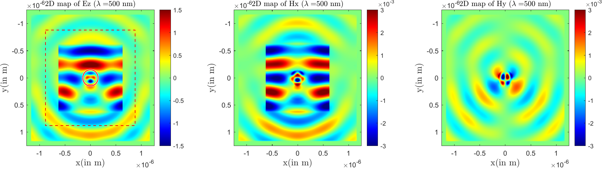
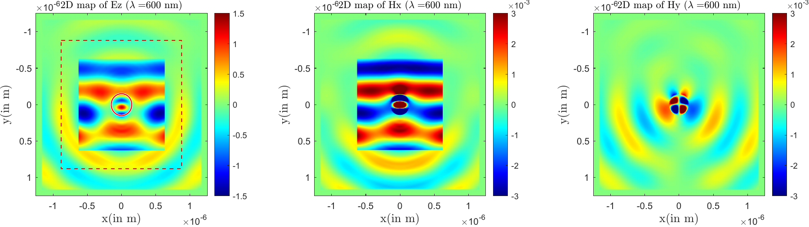
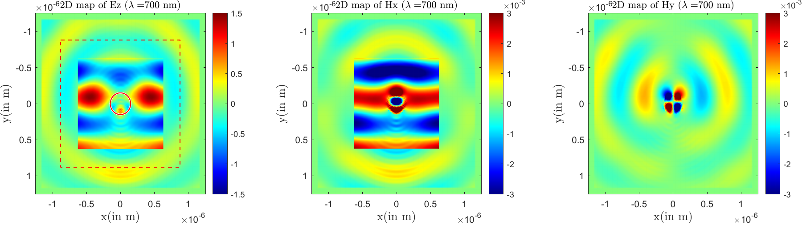
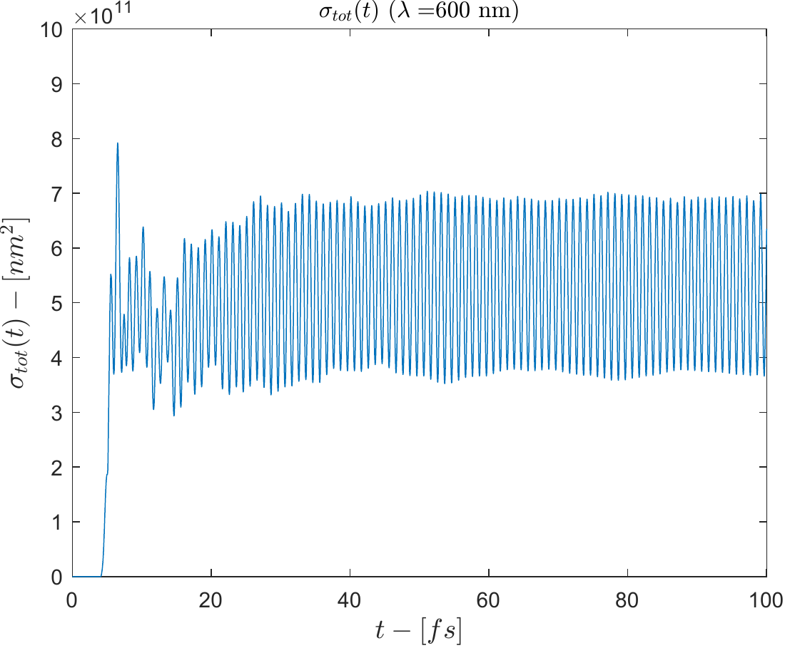

# 2D FDTD: Plane-Wave Scattering by a Dielectric Cylinder

A MATLAB implementation of the two-dimensional finite-difference time-domain (FDTD) method for an electromagnetic plane wave propagating along +y and scattering from a circular silicon inclusion in vacuum. Developed as an ECE 735 final project, the simulation uses TM polarization (Ez, Hx, Hy). The circular cross section represents an infinite cylinder along z.

See the [project report](fdtd_project_report/fdtd_2d_scatter_report.pdf) for derivations and results.

## Numerical Methods

- **Yee grid:** Electric and magnetic fields are staggered in space and time. Central differences and leapfrog updates discretize Maxwell's curl equations.
- **TF/SF excitation:** A Total-Field/Scattered-Field interface separates the interior total field from the exterior scattered field. An auxiliary 1D FDTD simulation supplies the incident fields for interface corrections.
- **PML boundaries:** Berenger's split-field PML separates Ez into Ezx and Ezy and uses polynomial conductivity profiles to absorb outgoing waves.
- **Acceleration:** Vectorized operations, `gpuArray`, and mirror symmetry about x = 0 reduce computation; Ez and Hx are even in x, while Hy is odd.
- **Source variants:** Continuous sinusoidal excitation, modulated Gaussian pulses (MGP), and differential Gaussian pulses (DGP), with an experimental implementation of discrete Fourier accumulation at the monitors.

## Model Setup

The following values describe the current single-frequency configuration in `Dielectric_Cylinder_Setup.m`. Earlier results and pulse configurations may use different grids and simulation durations.

| Parameter | Value |
| --- | --- |
| Scatterer | Cylinder of radius 150 nm, refractive index n = 3.48, μ = μ₀ |
| Material model | Lossless, nondispersive, constant refractive index; vacuum background |
| Incident wave | Wavelength 600 nm; Ez amplitude 1 V/m |
| Grid | 601 × 601; Δx = Δy = 10 nm |
| Time step | `min(0.9*dx/(sqrt(2)*c*n), T/100)`; approximately 25 optical periods |
| PML | 25 cells per side; polynomial order 6; target reflection parameter `Rf0 = 1e-8` |

The report presents field maps and scattering results at 500, 600, and 700 nm. The batch script specifies wavelengths from 450 to 750 nm in 50 nm increments.

## Measurements and Outputs

Scattered fields are sampled along a square contour outside the TF/SF interface and inside the PML. Spatial and temporal averaging aligns the staggered magnetic fields with the electric field before integrating the outward Poynting flux, **S = E × H**. Normalization by the mean incident intensity, `Iinc = ε₀ c E₀² / 2`, gives the quantity called total scattering cross section in the report: `σtot(t) = Pscat(t) / Iinc`. The report discusses its nonzero mean and oscillation at twice the incident frequency.

Outputs include 2D maps of Ez, Hx, and Hy, time traces of the scattering quantity, and `.mat` files containing field matrices, grid settings, and time parameters. `GPU05` also explores scattering spectra from the frequency-domain fields of pulse excitation.

**Units:** In this 2D model, the contour integral gives scattered power per unit length along z. Dividing by incident intensity therefore yields a scattering width with units of length. The existing report and post-processing label this quantity in nm²; the unit labels and conversion require correction.

## Simulation Results

The images below are PNG previews of the original simulation figures included in the report. Click each image to open its PDF.

### Field Maps

Each row shows **Ez, Hx, and Hy**, from left to right. The central region contains the total field; the surrounding region contains the scattered field. In the Ez panel, the red circle marks the cylinder and the dashed square marks the monitoring contour. These are snapshots from separate wavelength runs, not successive frames of an animation.

**500 nm**

  

**600 nm**

  

**700 nm**

  

### Scattering Time Trace

The 600 nm result shows an initial transient followed by sustained oscillations. The original axis labels are preserved; see the units note above when interpreting the vertical scale.

  

No saved animation is included in this repository. The simulation scripts update the field display during execution, but do not export a GIF or video.

## Files

The main MATLAB code is in [`fdtd_simulation_code/`](fdtd_simulation_code/).

| File or directory | Purpose |
| --- | --- |
| `FDTD_2D_TM_PWTFSF_PML_SiScatter_GPU03.m` | Single-frequency TM simulation with GPU acceleration, mirror symmetry, and time-domain flux monitoring |
| `FDTD_2D_TM_PWTFSF_PML_SiScatter_GPU05.m` | Experimental source variants and Fourier accumulation; defaults to MGP |
| Other `FDTD_*.m` files | Original CPU implementation and intermediate GPU versions |
| `Dielectric_Cylinder_Setup*.m` | Material, geometry, grid, and source settings for sinusoidal, MGP, and DGP excitation |
| `get_*.m`, `intialize_field_components.m` | Update coefficients, material maps, PML profiles, region indices, and field initialization |
| `vars2GPU.m`, `SetupPlot.m` | Transfer fields and coefficients to the GPU; display field maps |
| `post_processing_old.m` | Plot single-frequency time-domain results and export PDF/MAT files |
| `post_processing.m` | Experimental frequency-domain post-processing for pulse excitation |
| `script_batch_run_fdtd.m` | Modify the wavelength and run simulations and post-processing sequentially |
| `fdtd_saved_image_folder/`, `fdtd_saved_data_folder/` | Saved PDF figures and MAT data |
| [`fdtd_project_report/`](fdtd_project_report/) | PDF report; `figures/` contains schematics and reported results |

## Current Limitations

- The report identifies additional high-frequency waves appearing during long simulations; this issue remains unresolved.
- `GPU05` and frequency-domain post-processing are experimental. Frequency variables in some source branches, spectral normalization, and plot labels still need completion and validation.
- Earlier versions preserve the development history and may not run directly. The original CPU script references `create_grid_with_circle`, which is absent from this folder.
